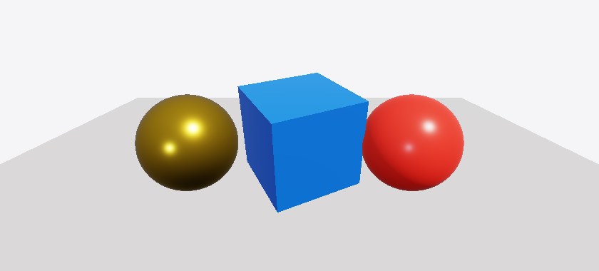
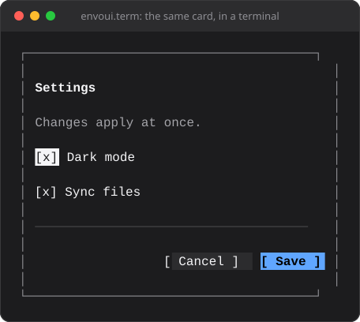
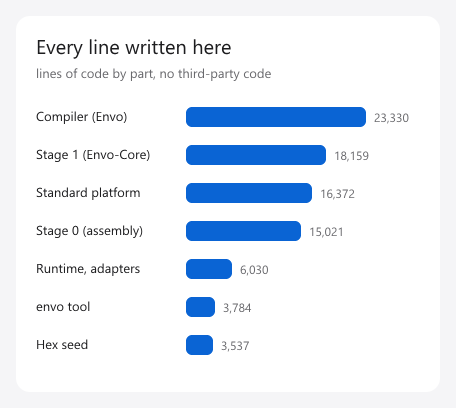
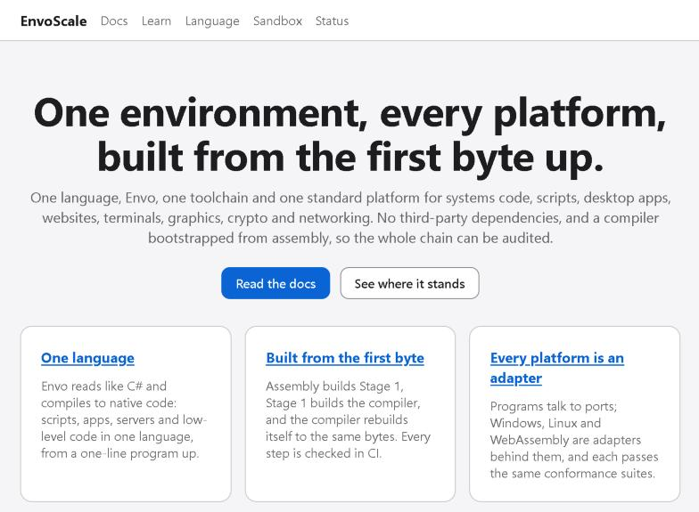
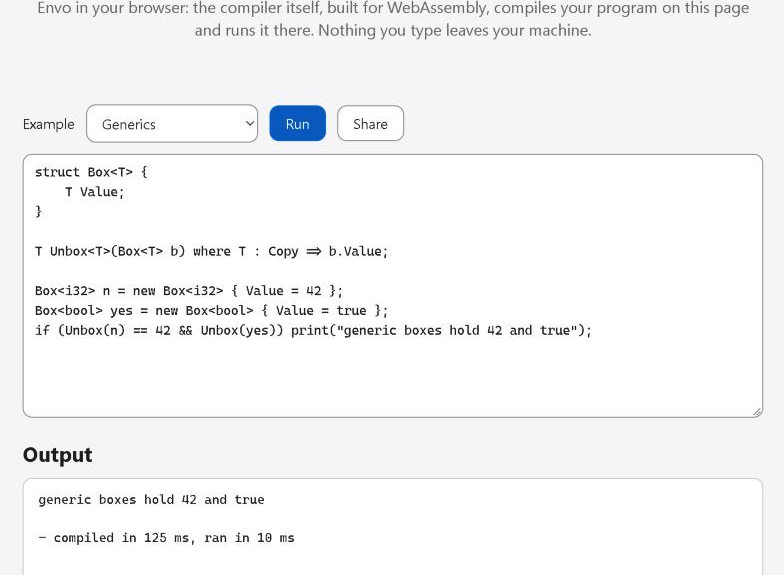

<div align="center">


### One language for everything you build.

Envol is a programming language, and EnvoScale is everything around it in one place: the
compiler, the standard library and the `envo` tool. Command-line programs, servers, apps,
websites, graphics and AI, with no third-party code anywhere.

<a href="https://discord.gg/Ev9ZeRVrX5"></a> <a href="https://github.com/orgs/envoscale/projects/3"></a>

</div>

<br>

<p align="center">
  
</p>

## Envide, written in Envol

<p align="center">
  
  <br>
  <sub><b>Envide</b> drawing itself: the sidebar, tabs, editor and status bar are <a href="https://github.com/envoscale/Envoui">Envoui</a>, the pixels and fonts are <a href="https://github.com/envoscale/Envor">Envor</a></sub>
</p>

## A taste of Envol

```cs
use alloc.text;

interface IShape {
    i64 Area(in this);
    str Name(in this);
}

struct Square : IShape {
    i64 Side;

    public i64 Area(in this) => this.Side * this.Side;
    public str Name(in this) => "square";
}

// One copy of Describe per type it is called with: no virtual calls.
void Describe<T>(in T shape) where T : IShape {
    string line = string.From(shape.Name());
    line.Append(": ");
    line.Append(text.Int(shape.Area()).AsStr());
    print(line.AsStr());
}

Describe(new Square { Side = 4 });
```

```
$ envo run .
square: 16
```

Every [example](https://github.com/envoscale/EnvoScale/tree/main/examples) runs in CI,
as a script and natively, against the output its README shows.

## See it

Every image here was made by EnvoScale itself: screenshots of its website, or pixels
rendered by its own libraries.

<p align="center">
  
  <br>
  <sub><b>3D</b> with <code>envor.render3d</code>: physically based shading on the CPU, the same pixels on every platform</sub>
</p>

<p align="center">
  
  <br>
  <sub><b>Native UI</b> with Envoui and <code>envor.theme</code>, light and dark, both WCAG AA</sub>
</p>

<p align="center">
  
  
  <br>
  <sub><b>The same card in a terminal</b> &nbsp;·&nbsp; <b>2D</b> with <code>envor.gfx</code> and <code>envor.font</code></sub>
</p>

<p align="center">
  
  
  <br>
  <sub><b>The website</b> is an Envol program &nbsp;·&nbsp; <b>The sandbox</b> runs the compiler itself in your browser</sub>
</p>

## The family

| | |
|---|---|
| **[Envol](https://github.com/envoscale/EnvoScale)** | The language: its compiler, standard library and the `envo` tool (build, run, test, format, debug, profile, packages) |
| **[Envor](https://github.com/envoscale/Envor)** | Rendering: 2D, TrueType fonts, 3D with glTF, and the themes |
| **[Envoui](https://github.com/envoscale/Envoui)** | The UI framework: one component tree for windows, browsers and terminals |
| **[Envide](https://github.com/envoscale/EnvoScaleStudio)** | The IDE, built on Envoui |
| **[EnvoScaleWeb](https://github.com/envoscale/EnvoScaleWeb)** | Websites in Envol, and this project's site |
| **[EnvoScaleAsm](https://github.com/envoscale/EnvoScaleAsm)** | The compiler built up from a few kilobytes of readable assembly |
| **Envos** | Planned: a small operating system, Linux's bare bones with a Mac's ease |

## Runs everywhere

<p align="center">
  
</p>

## Built from the ground up

A seed of readable hex builds an assembler, which builds a compiler written in assembly.
Each later compiler is written in more of Envol and built by the one before it, until the
compiler builds itself. That chain lives in
[EnvoScaleAsm](https://github.com/envoscale/EnvoScaleAsm), whose CI publishes the seed
compiler EnvoScale starts from, only when Linux and Windows built the same bytes.

<p align="center">
  
</p>

## What's inside

| | |
|---|---|
| **Language** | ownership without a garbage collector, generics, interfaces, closures, enums with `match`, checked arithmetic |
| **Toolchain** | one `envo` binary: new, run, build, test, check, fmt, debugger, profiler, fuzzer, REPL, language server, signed packages |
| **Platform** | files and processes, HTTP and TLS, JSON, websites, native and terminal UI, 2D, fonts, 3D with glTF, local AI models, crypto |
| **Trust** | W^X and ASLR, fuzzed parsers, sandboxed scripts, reproducible and signed releases with SBOMs |

In the works: making Envol's generated code as fast as Rust's (the
[benchmarks](https://github.com/envoscale/EnvoScaleRust) compare the same compiler written
in both), and Envos.

## Progress

<p align="center">
  
</p>

Free for noncommercial use under the [PolyForm Noncommercial License 1.0.0](https://polyformproject.org/licenses/noncommercial/1.0.0/);
commercial use needs a commercial license.
