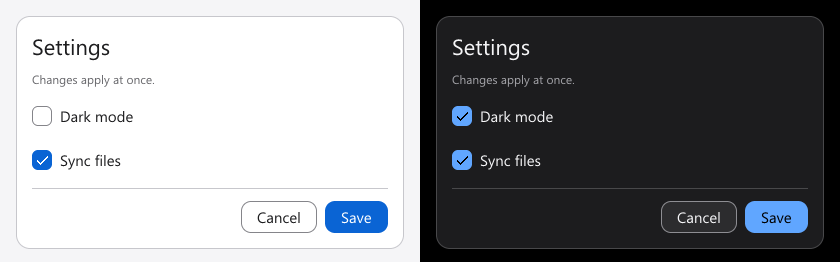

### One environment, every platform, built from the first byte up.

One language, one toolchain and one standard platform for systems code, apps, websites,
graphics, AI and networking. No third-party code anywhere.

 

 

  

## See it

Every image below was made by EnvoScale itself: screenshots of its website, or pixels
rendered by its own libraries.

  
  
   
  <b>The website</b> is an Envo program &nbsp;·&nbsp; <b>The sandbox</b> runs the compiler itself in your browser

  
   
  <b>3D</b> with <code>envo.render3d</code>: physically based shading on the CPU, the same pixels on every platform

  
   
  <b>Native UI</b> with <code>envo.ui</code> and Lumen, light and dark, both WCAG AA

  
  
   
  <b>The same card in a terminal</b> &nbsp;·&nbsp; <b>2D</b> with <code>envo.gfx</code> and <code>envo.font</code>

## Runs everywhere

  

## Built from the first byte

A seed of readable hex builds an assembler, which builds a compiler written in assembly.
Each later compiler is written in more of Envo and built by the one before it, until the
compiler builds itself.

  

## What's inside

| | |
|---|---|
| **Language** | Envo: ownership without a garbage collector, generics, interfaces, closures, enums with `match`, checked arithmetic |
| **Toolchain** | one `envo` binary: new, run, build, test, check, fmt, debugger, profiler, fuzzer, REPL, language server, signed packages |
| **Platform** | files and processes, HTTP and TLS, JSON, websites, native and terminal UI, 2D, fonts, 3D with glTF, local AI models, crypto |
| **Trust** | W^X and ASLR, fuzzed parsers, sandboxed scripts, reproducible and signed releases with SBOMs |

## Progress

  

Free for noncommercial use under the [PolyForm Noncommercial License 1.0.0](https://polyformproject.org/licenses/noncommercial/1.0.0/);
commercial use needs a commercial license.
