### One environment, every platform, every skill level, built from the first byte up.

One language (**Envo**), one toolchain (`envo`) and one standard platform (`envo.*`)
for systems code, scripts, desktop apps, websites, terminals, graphics, AI, cryptography and networking.
No third-party dependencies. The compiler is bootstrapped from assembly, so the whole chain can be audited.

&nbsp;

 

  

## Built from the first byte

Nothing in the chain is borrowed. Stage 0 is a compiler written in x86-64 assembly that
writes Windows and Linux executables directly: no C runtime, no linker, no libraries. Each
later compiler is written in a larger slice of Envo and built by the one before it, until the
compiler compiles itself and the result stops changing.

  

## Stage 1, end to end

`envoc1` is the first compiler written in Envo itself. It lexes, parses, type-checks, lowers to
EIR (a typed SSA intermediate form with its own verifier), generates x86-64 and writes PE and
ELF images, with a runtime that is also written in Envo. Every test program is compiled by both
`envoc0` and `envoc1`, and the outputs must agree.

  

## Hello, World, everywhere

Each domain gets a "Hello World" that fits in one to three lines. The gallery is part of the
test suite: CI fails if a program stops working or grows longer. Only the console line runs
today. The others are the target, and each lights up when its milestone lands.

  

## Where it stands

  

| | |
|---|---|
| **Done** | **M0** charter, specs and skeleton · **M1** Stage 0 (`envoc0`, about 15k lines of assembly), which compiles Envo-Core on Windows and Linux with byte-identical builds on every host |
| **Now** | **M2** Stage 1 (`envoc1`, about 11k lines of Envo-Core): lexer, parser, checker, EIR, backend and runtime all work; generics, interfaces, closures and the borrow checker come next |
| **Next** | **M3** self-hosting and the fixed point · **M4–M6** standard library, `envo` CLI and script runtime · **M7–M9** crypto, networking, UI and web · **M10–M13** AArch64 and macOS, 3D, AI and the ecosystem |

The project is early and moving fast. Progress is tracked in the open on the
[roadmap](https://github.com/orgs/envoscale/projects/3), and you can chat with us on
[Discord](https://discord.gg/fzfArKeZaG).

## License

EnvoScale is free for personal, educational, research and other noncommercial use under the
[PolyForm Noncommercial License 1.0.0](https://polyformproject.org/licenses/noncommercial/1.0.0/).
Commercial use requires an EnvoScale commercial license.

The animations on this page are plain SVG and CSS with no scripts or external resources, and they respect your reduced-motion setting.
